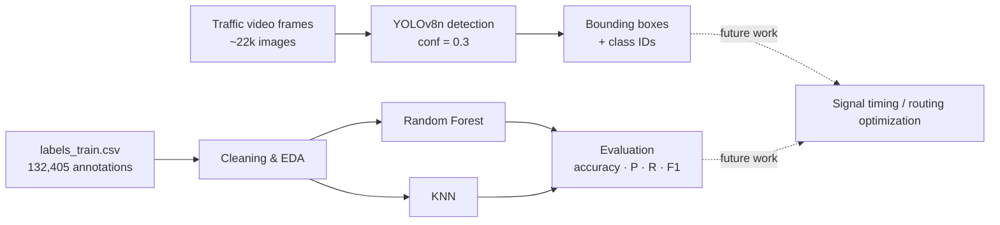

<div align="center">

# 🚦 SmartFlow — Machine Learning-Based Traffic Optimization for Autonomous Vehicles

**Traffic object detection with YOLOv8 and bounding-box classification with Random Forest & KNN**


*MSc Advanced Computer Science project — University of Hertfordshire (7COM1039)*

</div>

---

## 📖 Overview

Traditional traffic-control systems were designed for human drivers and react to congestion after it happens. **SmartFlow** explores how machine learning can give autonomous vehicles and traffic infrastructure a more proactive view of the road.

This repository contains the machine-learning pipeline built for the project:

1. **Traffic detection** – a pretrained **YOLOv8n** model detects cars, trucks, pedestrians and traffic lights in ~22,000 dashcam frames.
2. **Traffic classification** – **Random Forest** and **K-Nearest Neighbors** classifiers are trained on bounding-box geometry from **132,405 annotated objects** and compared.

> 📄 The full write-up (literature review, methodology, results and critical analysis) is the project's *Final Progress Report*.

## ✨ Highlights

- 🔍 Real-time-capable object detection with YOLOv8n (≈100 ms/frame on Colab GPU)
- 📊 Full exploratory data analysis: class imbalance, bounding-box distributions, correlations, pair plots
- 🌲 Random Forest vs 🎯 KNN comparison with per-class precision/recall/F1 and confusion matrices
- 🧱 Clean, reproducible scripts with command-line arguments (`src/`)

## 🧭 Pipeline



## 🗂️ Dataset

| Item | Detail |
|---|---|
| Source | Kaggle – self-driving cars traffic frames ([notebook used](https://www.kaggle.com/code/youssefhassan1234/object-detection-by-using-yolov8/input)) |
| Images | JPEG dashcam frames (416×640 inference), **22,241** processed |
| Annotations | `labels_train.csv` — **132,405** rows: `frame, xmin, xmax, ymin, ymax, class_id` |
| Classes | 5 (`class_id` 1–5); heavily imbalanced |
| Split | 70 % train / 30 % test (`random_state=42`) → 39,722 test samples |

**Class distribution (imbalanced)**

| class_id | Count |
|:-:|--:|
| 1 | 101,314 |
| 5 | 12,700 |
| 3 | 10,637 |
| 2 | 6,313 |
| 4 | 1,442 |

<p align="center"></p>

## 📈 Results

### Detection (YOLOv8n)

- Pretrained `yolov8n.pt`, confidence threshold **0.3**
- Processed **22,241 frames** in ≈10 minutes on a Colab GPU (≈100 ms per frame)
- Reliably detects cars and traffic lights; minor box overlaps in crowded scenes

### Classification (bounding-box features → `class_id`)

| Model | Accuracy | Macro Precision | Macro Recall | Macro F1 |
|---|:-:|:-:|:-:|:-:|
| 🌲 Random Forest (100 trees) | **0.93** | **0.85** | 0.70 | 0.75 |
| 🎯 KNN (default k) | **0.93** | 0.84 | **0.71** | **0.76** |

**Random Forest — per-class report**

| Class | Precision | Recall | F1 | Support |
|:-:|:-:|:-:|:-:|--:|
| 1 | 0.94 | 0.98 | 0.96 | 30,378 |
| 2 | 0.76 | 0.51 | 0.61 | 1,899 |
| 3 | 0.88 | 0.76 | 0.81 | 3,161 |
| 4 | 0.73 | 0.31 | 0.44 | 442 |
| 5 | 0.94 | 0.96 | 0.95 | 3,842 |

Both models perform very well on frequent classes and struggle on rare ones (classes 2 and 4) because of class imbalance — accuracy is therefore flattering, and macro-averaged recall is the more honest number.

<table>
  <tr>
    <td align="center"><b>Random Forest — confusion matrix</b><br></td>
    <td align="center"><b>KNN — confusion matrix</b><br></td>
  </tr>
  <tr>
    <td align="center"><b>Feature importance (Random Forest)</b><br></td>
    <td align="center"><b>Metric comparison</b><br></td>
  </tr>
</table>

### Exploratory analysis

<table>
  <tr>
    <td align="center"><b>Bounding-box width vs height</b><br></td>
    <td align="center"><b>Feature correlation heatmap</b><br></td>
  </tr>
</table>

<details>
<summary>More plots</summary>


</details>

## 📁 Project structure

```
Traffic_detection_ML/
├── README.md
├── LICENSE
├── requirements.txt
├── .gitignore
├── assets/
│   └── images/               # Figures used in this README
├── data/                     # Dataset goes here (not tracked — see data/README.md)
├── docs/                     # Report and supporting documents
├── models/                   # Trained / downloaded weights (not tracked)
├── notebooks/                # Google Colab / Jupyter notebooks
├── outputs/                  # Generated detections, plots and metrics (not tracked)
└── src/
    ├── detect_objects.py     # YOLOv8 detection on a folder of frames
    └── train_classifiers.py  # Random Forest vs KNN training & evaluation
```

## 🚀 Getting started

### 1. Clone and install

```bash
git clone https://github.com/atulparashar01/Traffic_detection_ML.git
cd Traffic_detection_ML

python -m venv .venv
source .venv/bin/activate        # Windows: .venv\Scripts\activate
pip install -r requirements.txt
```

### 2. Get the data

Download the dataset from Kaggle and place it like this (details in [`data/README.md`](data/README.md)):

```
data/
├── images/            # *.jpg frames
└── labels_train.csv
```

### 3. Run object detection

```bash
python src/detect_objects.py --source data/images --conf 0.3
```

Annotated frames are written to `outputs/detect/traffic_detect/`.

### 4. Train and compare classifiers

```bash
python src/train_classifiers.py --csv data/labels_train.csv --out outputs/classification
```

This prints per-class reports for both models and saves confusion matrices, feature importances and a `metrics_summary.csv` to `outputs/classification/`.

> 💡 The original experiments were run in **Google Colab** with the data on Google Drive. The scripts above are path-independent versions of that code.

## ⚠️ Scope and limitations

Being upfront about what this project does and does not do:

- The YOLOv8n model is used **pretrained** (not fine-tuned on this dataset).
- The classifiers predict `class_id` from **bounding-box coordinates only** — a baseline experiment, not a full congestion or signal-control model. Adding features such as vehicle density, frame-level counts and temporal context would be the natural next step.
- Class imbalance is **not** corrected (no resampling or class weights), which explains the weak recall on classes 2 and 4.
- Adaptive signal control, V2X communication and rerouting are covered in the report as the **system vision / literature context**; they are not implemented in this repository.
- Only one urban dashcam dataset was used, so generalisation to other cities, weather and camera setups is untested.

## 🔭 Future work

- Fine-tune YOLOv8 on the annotated dataset and report mAP
- Handle class imbalance (class weights, SMOTE, focal loss)
- Add temporal analysis across video sequences and per-frame vehicle-density features
- Deep reinforcement learning (e.g. DQN) for adaptive signal timing
- Edge deployment, multi-modal traffic (pedestrians, cyclists, buses) and real-world pilots

## 📚 Key references

- Mushtaq et al. (2021). *Traffic flow management of autonomous vehicles using deep reinforcement learning and smart rerouting.* IEEE Access, 9.
- Wu et al. (2017). *Flow: A modular learning framework for autonomy in traffic.* arXiv:1710.05465
- Biau & Scornet (2016). *A random forest guided tour.* TEST, 25(2).
- Tang et al. (2019). *A review of traffic congestion prediction using artificial intelligence.* Journal of Advanced Transportation.

## 👤 Author

**Atul** — MSc Advanced Computer Science, University of Hertfordshire
Supervisor: Mr. Gani Nashi
GitHub: [@atulparashar01](https://github.com/atulparashar01)

## 📜 License

Released under the [MIT License](LICENSE). The dataset is subject to its own Kaggle license/terms.

---

<div align="center">⭐ If you found this project useful, consider giving it a star!</div>
